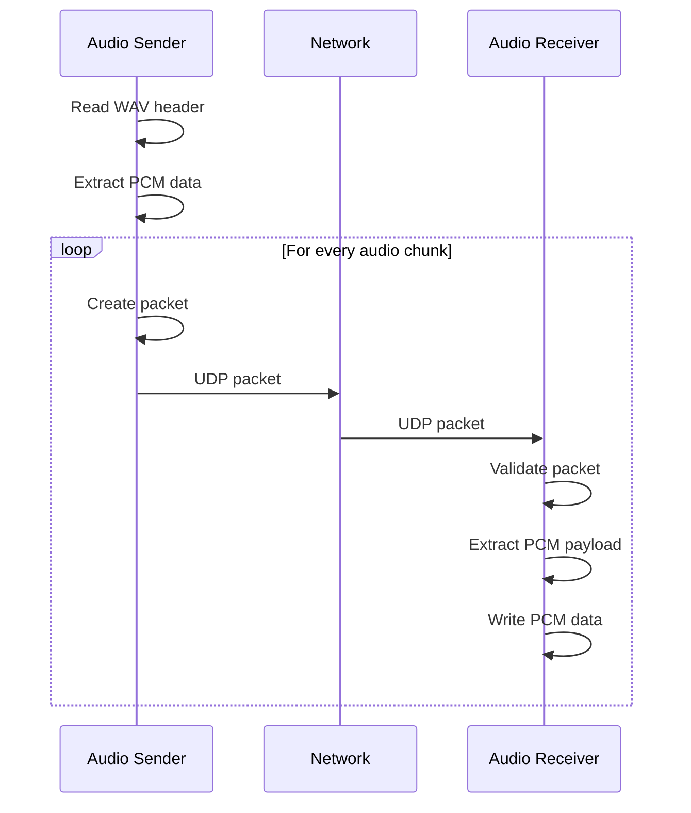
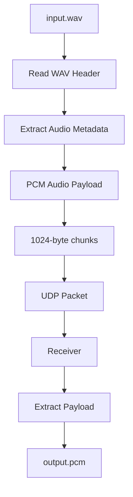
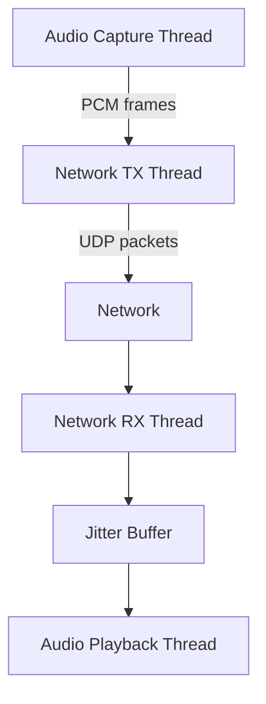
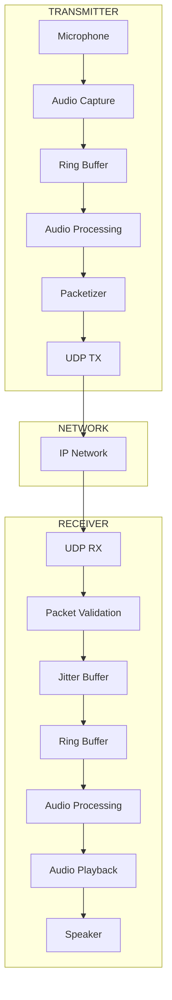

# 🎧 AudioOverUDP

> **A low-level audio transport and streaming system built in C using UDP sockets on Linux.**

AudioOverUDP is a systems-level C project focused on understanding how audio data can be transported across a network using **UDP sockets**.

The project is being developed incrementally—from raw WAV/PCM data transmission to a complete real-time audio streaming pipeline with packet sequencing, loss detection, buffering, and live audio I/O.

---

## 🧠 Background

Modern audio streaming systems hide a significant amount of complexity behind high-level frameworks and protocols.

AudioOverUDP was created to explore what happens underneath those abstractions.

The project focuses on questions such as:

* How is audio represented as raw PCM data?
* How can binary audio data be transported using UDP?
* How should large audio streams be divided into network packets?
* What happens when UDP packets are lost?
* How can packet ordering be detected?
* How can network jitter affect real-time audio?
* How can buffering be used to compensate for network variation?
* How can Linux audio devices interface with a custom networking stack?
* How can a real-time streaming system be designed using C?

The goal is not simply to make audio "work", but to understand the **systems and networking fundamentals behind real-time audio communication**.

---

# 🎯 Project Goals

AudioOverUDP aims to evolve into a lightweight real-time audio transport system implemented from the ground up.

### Current goals

* [x] UDP socket communication
* [x] WAV file parsing
* [x] PCM audio extraction
* [x] Audio data packetization
* [x] UDP transmission
* [x] UDP reception
* [x] Packet sequence numbers
* [x] Basic custom packet header

### Planned goals

* [ ] Packet-loss detection
* [ ] Out-of-order packet detection
* [ ] Network statistics
* [ ] WAV reconstruction
* [ ] Microphone capture
* [ ] Real-time audio streaming
* [ ] Audio playback
* [ ] Jitter buffer
* [ ] Ring buffer
* [ ] Multithreaded producer/consumer architecture
* [ ] Streaming latency measurements
* [ ] Performance optimization

---

# 🏗️ System Architecture

## Current Architecture

The current implementation operates on a file-based pipeline.


The sender reads a WAV file, extracts its PCM payload, divides the data into fixed-size chunks, and transmits those chunks using UDP.

The receiver extracts the audio payload from each UDP packet and writes the received PCM data to disk.

---

# 📡 UDP Communication Architecture



---

# 📦 Packet Architecture

AudioOverUDP uses a custom packet header.

```text
┌─────────────────────────────────────────┐
│              UDP Payload                │
├─────────────────────────────────────────┤
│ Magic Number       │ 4 bytes            │
├────────────────────┼────────────────────┤
│ Sequence Number    │ 4 bytes            │
├────────────────────┼────────────────────┤
│ Audio Data Size    │ 2 bytes            │
├────────────────────┼────────────────────┤
│                                         │
│             PCM Audio Data              │
│                                         │
│             Up to 1024 bytes            │
│                                         │
└─────────────────────────────────────────┘
```

### Header

```c
typedef struct
{
    uint32_t magic;
    uint32_t sequence;
    uint16_t data_size;
} AudioPacketHeader;
```

### Fields

| Field         |         Size | Purpose                           |
| ------------- | -----------: | --------------------------------- |
| `magic`       |      4 bytes | Identifies an AudioOverUDP packet |
| `sequence`    |      4 bytes | Identifies packet order           |
| `data_size`   |      2 bytes | Number of valid audio bytes       |
| Audio payload | ≤ 1024 bytes | PCM audio data                    |

The sequence number will later be used for packet-loss and ordering analysis.

---

# 🔊 Audio Data Flow

The current implementation works with **uncompressed PCM WAV audio**.



Using raw PCM initially keeps the project focused on **network transport and systems programming**, rather than introducing codec complexity.

---

# 📂 Project Structure

```text
AudioOverUDP/
│
├── CMakeLists.txt
│
├── LICENSE
│
├── README.md
│
├── include/
│   ├── audio.h
│   ├── protocol.h
│   └── udp.h
│
├── src/
│   ├── audio.c
│   ├── receiver.c
│   ├── sender.c
│   └── udp.c
│
├── audio/
│   ├── input.wav
│   └── output.pcm
│
└── build/
    ├── audio_sender
    └── audio_receiver
```

### Module responsibilities

#### `protocol.h`

Defines the network protocol:

```text
Packet format
Constants
Audio payload size
UDP port
Magic number
```

#### `udp.h / udp.c`

Responsible for:

```text
UDP socket creation
Socket binding
Data transmission
Data reception
Socket cleanup
```

#### `audio.h / audio.c`

Responsible for:

```text
WAV header parsing
Audio metadata extraction
PCM data handling
```

#### `sender.c`

Responsible for:

```text
Opening WAV
Parsing WAV
Reading PCM
Creating packets
Sending UDP packets
```

#### `receiver.c`

Responsible for:

```text
Creating UDP socket
Receiving packets
Validating packets
Extracting PCM
Writing output
```

---

# 🛠️ Technology Stack

| Technology        | Usage                |
| ----------------- | -------------------- |
| **C17**           | Core implementation  |
| **Linux**         | Runtime platform     |
| **POSIX Sockets** | UDP networking       |
| **GCC**           | Compiler             |
| **CMake**         | Build system         |
| **WAV / PCM**     | Initial audio format |
| **UDP / IPv4**    | Network transport    |
| **Git**           | Version control      |

No external networking library is required for the current implementation.

The networking layer uses the Linux/POSIX socket API directly.

---

# ⚙️ Build Requirements

Tested development environment:

```text
Linux
GCC
CMake
POSIX socket API
```

Install the basic development tools:

```bash
sudo apt update
sudo apt install build-essential cmake
```

Verify:

```bash
gcc --version
cmake --version
```

---

# 🚀 Building

Clone the repository:

```bash
git clone https://github.com/SaiSundarP/AudioOverUDP.git
cd AudioOverUDP
```

Create the build directory:

```bash
cmake -S . -B build
```

Build:

```bash
cmake --build build
```

The following executables will be generated:

```text
build/audio_sender
build/audio_receiver
```

---

# ▶️ Running the Project

## 1. Start the receiver

Open Terminal 1:

```bash
./build/audio_receiver
```

Expected:

```text
Waiting for UDP audio...
```

The receiver listens on:

```text
UDP port: 5000
```

---

## 2. Start the sender

Open Terminal 2.

For testing on the same machine:

```bash
./build/audio_sender audio/input.wav 127.0.0.1
```

The sender will display WAV information:

```text
WAV information:
Channels       : 2
Sample rate    : 44100 Hz
Bits/sample    : 16
Data size      : ...
```

Then transmission begins:

```text
Sent packet: 1
Sent packet: 2
Sent packet: 3
...
```

The receiver should display:

```text
Received packet: 0
Received packet: 1
Received packet: 2
...
```

---

# 🌐 Network Testing

The system can also be tested between two Linux machines on the same network.

### Receiver

On Machine A:

```bash
./build/audio_receiver
```

### Sender

Find Machine A's IP:

```bash
ip addr
```

Then run on Machine B:

```bash
./build/audio_sender audio/input.wav <RECEIVER_IP>
```

Example:

```bash
./build/audio_sender audio/input.wav 192.168.1.100
```

Make sure UDP port `5000` is allowed through the firewall.

---

# 📊 Current Data Path

```text
                  AudioOverUDP

┌─────────────┐
│  input.wav  │
└──────┬──────┘
       │
       ▼
┌─────────────┐
│ WAV Parser  │
└──────┬──────┘
       │
       ▼
┌──────────────┐
│ PCM Extractor│
└──────┬───────┘
       │
       ▼
┌────────────────┐
│ Packet Builder │
└───────┬────────┘
        │
        ▼
┌────────────────┐
│   UDP Socket   │
└───────┬────────┘
        │
        │ Network
        ▼
┌────────────────┐
│   UDP Socket   │
└───────┬────────┘
        │
        ▼
┌────────────────┐
│ Packet Parser  │
└───────┬────────┘
        │
        ▼
┌──────────────┐
│ output.pcm   │
└──────────────┘
```

---

# ⚠️ Why UDP?

UDP was intentionally selected instead of TCP.

### TCP

```text
Reliable
Ordered
Connection-oriented
Retransmission
Congestion control
```

### UDP

```text
Connectionless
Low protocol overhead
No guaranteed delivery
No guaranteed ordering
No retransmission
```

For real-time audio, waiting for retransmission of an old packet can be undesirable.

For example:

```text
Packet 1
Packet 2
Packet 3  ← LOST
Packet 4
Packet 5
```

A real-time application may prefer:

```text
1 → 2 → 4 → 5
```

rather than stopping playback while waiting for packet 3.

This makes packet-loss handling and buffering important future components of AudioOverUDP.

---

# 🧪 Current Limitations

The current implementation is intentionally an early-stage prototype.

### No packet recovery

Lost UDP packets are not retransmitted.

### No jitter buffer

Packets are currently processed as they arrive.

### No real-time microphone capture

The current input is a WAV file.

### No real-time speaker playback

The receiver currently writes PCM data to disk.

### No packet-loss statistics

Sequence numbers exist in the protocol, but comprehensive network statistics are still planned.

### WAV parser limitations

The current WAV parser targets a simple standard PCM WAV structure and does not yet implement a general RIFF chunk parser.

---

# 🗺️ Development Roadmap

## Phase 1 — File Transport

**Status: 🟢 Current**

```text
WAV
 ↓
PCM
 ↓
UDP
 ↓
PCM
```

Implemented:

* UDP sockets
* WAV parsing
* PCM extraction
* Packet header
* Sequence numbers
* Sender
* Receiver

---

## Phase 2 — Reliable Packet Analysis

**Status: 🟡 Planned**

```text
Packet
   ↓
Sequence Number
   ↓
Packet Validation
   ↓
Loss Detection
   ↓
Statistics
```

Planned metrics:

```text
Packets transmitted
Packets received
Packets lost
Packet loss %
Out-of-order packets
Bytes transmitted
Bytes received
```

---

## Phase 3 — WAV Reconstruction

**Status: 🟡 Planned**

The receiver will reconstruct:

```text
WAV Header
+
PCM Payload
```

producing:

```text
received.wav
```

---

## Phase 4 — Real-Time Audio

**Status: 🟡 Planned**

The architecture will become:

```mermaid
flowchart LR

    MIC["Microphone"] --> CAP["Audio Capture"]

    CAP --> BUF1["Capture Buffer"]

    BUF1 --> PACK["Packetizer"]

    PACK --> UDP1["UDP Sender"]

    UDP1 --> NET["Network"]

    NET --> UDP2["UDP Receiver"]

    UDP2 --> JIT["Jitter Buffer"]

    JIT --> BUF2["Playback Buffer"]

    BUF2 --> PLAY["Audio Playback"]

    PLAY --> SPK["Speaker"]
```



---

# 🧵 Phase 5 — Concurrent Architecture

Real-time streaming will require independent processing paths.



This stage will introduce:

* POSIX threads
* Mutexes
* Condition variables
* Ring buffers
* Producer/consumer architecture
* Timing synchronization

---

# 📈 Performance Metrics

As the project evolves, performance will be measured using:

```text
Latency
Throughput
Packet loss
Jitter
CPU utilization
Memory usage
Buffer utilization
Packets/sec
Audio frames/sec
```

The goal is to turn AudioOverUDP from a basic networking experiment into a measurable systems project.

---

# 🔬 Learning Objectives

This project is designed to provide practical experience with:

### C

```text
Pointers
Structures
Memory management
Binary data
File I/O
Bit manipulation
Modular programming
Error handling
```

### Linux

```text
Processes
Threads
File descriptors
Sockets
Network interfaces
Audio devices
System APIs
```

### Networking

```text
IPv4
UDP
Socket programming
Packetization
Network byte order
Packet loss
Jitter
Latency
```

### Real-Time Systems

```text
Buffers
Ring buffers
Producer/consumer architecture
Timing
Synchronization
Deterministic data flow
```

---

# 🔐 Design Philosophy

AudioOverUDP follows a **layered architecture**.

```text
┌──────────────────────────────┐
│       Application Layer      │
│       Audio Streaming        │
├──────────────────────────────┤
│       Audio Processing       │
│       PCM / Buffers          │
├──────────────────────────────┤
│       Protocol Layer         │
│       Packet Header          │
├──────────────────────────────┤
│       Transport Layer        │
│       UDP                    │
├──────────────────────────────┤
│       Linux Socket API       │
├──────────────────────────────┤
│       Network Interface      │
└──────────────────────────────┘
```

The intention is to keep networking, protocol, audio, and application logic separated so each component can evolve independently.

---

# 📌 Example Packet

For a packet containing 1024 bytes of audio:

```text
UDP Payload
│
├── Magic       → 4 bytes
├── Sequence    → 4 bytes
├── Data Size   → 2 bytes
│
└── Audio Data  → 1024 bytes
```

Total payload:

```text
4 + 4 + 2 + 1024 = 1034 bytes
```

This remains comfortably below the typical Ethernet MTU when UDP/IP headers are included.

---

# 🧩 Future Architecture

The long-term architecture is intended to become:



---

# 🚧 Project Status

```text
Current Version: 1.0.0

Status: Active Development

Platform: Linux

Language: C17

Transport: UDP / IPv4

Audio: PCM WAV
```

### Current pipeline

```text
WAV → PCM → UDP → PCM
```

### Target pipeline

```text
Microphone
    ↓
PCM Capture
    ↓
Ring Buffer
    ↓
Packetizer
    ↓
UDP
    ↓
Jitter Buffer
    ↓
PCM Playback
    ↓
Speaker
```

---

# 📜 License

This project is licensed under the **MIT License**.

See [`LICENSE`](LICENSE) for details.

---

# 👨‍💻 Author

**Sai Sundar P**

Electrical & Electronics Engineering
Embedded Systems • Firmware • Linux • Robotics

---

> **AudioOverUDP is an ongoing exploration of networking, real-time systems, Linux, and low-level C programming.**
